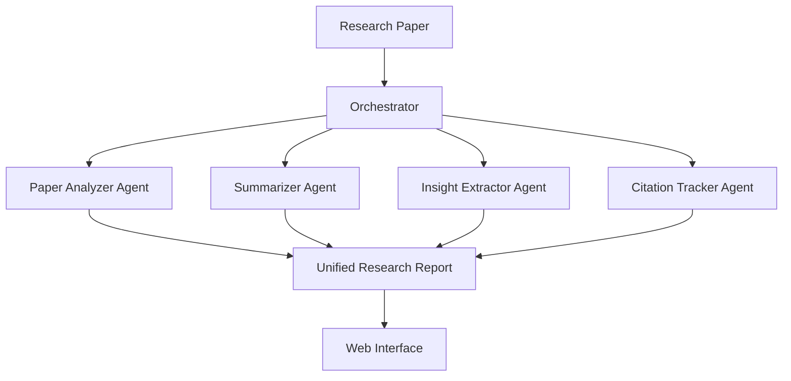

# 📚 ScholarPulse

### Your AI-powered research companion.

**ScholarPulse** is a multi-agent AI research assistant designed to simplify academic literature review. It helps researchers analyze academic papers, generate structured summaries, extract meaningful insights, and explore citation relationships — all through a unified interface.

Analyze papers. Discover insights. Accelerate research.

\<p align="center">
&#x20; \
&#x20; \
&#x20; \
&#x20; \
\</p>

---

## ✨ Why ScholarPulse?

Academic research involves reading lengthy papers, identifying important contributions, understanding methodologies, and tracing related work. Doing this manually across dozens of papers can be time-consuming.

ScholarPulse streamlines this process using a **multi-agent architecture**, where specialized AI agents collaborate to transform research papers into structured, accessible insights.

## 🚀 Key Features

- 🔍 **Research Paper Analysis** — Identify abstracts, methodologies, results, and limitations.
- 📝 **Intelligent Summarization** — Generate concise, structured summaries of academic papers.
- 💡 **Insight Extraction** — Highlight key contributions, findings, research gaps, and future directions.
- 🔗 **Citation Tracking** — Explore references and related research to understand connections between papers.
- 🤖 **Multi-Agent Intelligence** — Coordinate specialized agents through a central orchestrator.
- 🖥️ **Interactive Web Interface** — Access research analysis through a dedicated frontend and backend API.

## 🧠 System Architecture

ScholarPulse organizes research analysis into specialized agents coordinated by an orchestrator.



### Agent Responsibilities

| Component             | Responsibility                                         |
| --------------------- | ------------------------------------------------------ |
| **Orchestrator**      | Coordinates agents and combines their results          |
| **Paper Analyzer**    | Extracts and organizes paper content                   |
| **Summarizer**        | Produces concise summaries of key findings             |
| **Insight Extractor** | Identifies contributions, research gaps, and takeaways |
| **Citation Tracker**  | Analyzes references and citation relationships         |

## 🛠️ Technology Stack

| Layer             | Technologies                       |
| ----------------- | ---------------------------------- |
| Frontend          | React, JavaScript, HTML, CSS       |
| Backend           | Python                             |
| AI                | LLM API and multi-agent processing |
| API Communication | Backend API                        |
| Version Control   | Git and GitHub                     |

*The stack above describes the intended architecture; adjust it to match the technologies actually implemented in the repository.*

## 📂 Project Structure

```text
ScholarPulse/
├── backend/
│   ├── main.py
│   ├── requirements.txt
│   └── ...
├── frontend/
│   ├── package.json
│   ├── src/
│   └── ...
├── .gitignore
├── LICENSE
└── README.md
```

## ⚙️ Getting Started

### Prerequisites

Make sure you have the following installed:

- Python 3.10 or later
- Node.js 18 or later
- npm
- An API key for your chosen LLM provider

### 1. Clone the Repository

```bash
git clone https://github.com/sharanExplore/ScholarPulse.git
cd ScholarPulse
```

### 2. Set Up the Backend

Navigate to the backend directory:

```bash
cd backend
python -m venv venv
```

Activate the virtual environment.

**Windows — PowerShell**

```powershell
.\venv\Scripts\Activate.ps1
```

**Windows — Command Prompt**

```cmd
venv\Scripts\activate.bat
```

**Linux / macOS**

```bash
source venv/bin/activate
```

Install the dependencies:

```bash
pip install -r requirements.txt
```

Create a `.env` file inside the `backend/` directory and configure the API key expected by your application:

```env
LLM_API_KEY=your_api_key_here
```

> Replace the example variable with the actual environment variable name your backend reads. Never commit real API keys or secrets to GitHub.

Start the backend using the entry point configured in your project. If your application uses `main.py` directly:

```bash
python main.py
```

### 3. Set Up the Frontend

Open a second terminal from the project root:

```bash
cd frontend
npm install
npm run dev
```

Open the local URL printed in your terminal. Vite commonly uses `http://localhost:5173`.

### 4. Start Researching

Once both services are running:

1. Open the ScholarPulse web interface.
2. Upload a research paper or enter a supported paper identifier or URL.
3. Select the analysis you need.
4. Review the generated summary, extracted insights, and available citation information.

*Available inputs and analysis options depend on the implemented features.*

## 🎯 Use Cases

- **Students** — Understand research papers more efficiently.
- **Researchers** — Organize findings and identify potential research gaps.
- **Academic Teams** — Compare ideas and explore related literature.
- **Project Developers** — Investigate prior work before building new solutions.

## 🗺️ Roadmap

- [ ] Multi-paper comparison
- [ ] Interactive citation network visualization
- [ ] PDF and Markdown report export
- [ ] Personal research library
- [ ] Conversational Q&A over research papers
- [ ] Advanced filtering and search across academic literature

## 🤝 Contributing

Contributions, suggestions, and bug reports are welcome.

1. Fork the repository.

2. Create a feature branch:

   ```bash
   git checkout -b feature/your-feature
   ```

3. Commit your changes:

   ```bash
   git commit -m "Add your feature"
   ```

4. Push your branch:

   ```bash
   git push origin feature/your-feature
   ```

5. Open a pull request describing your changes.

## 🔐 Security

- Keep API keys in environment variables.
- Add `.env` and virtual environment directories to `.gitignore`.
- Never publish credentials, tokens, or private research documents unintentionally.

## 📄 License

This project is distributed under the MIT License. See the [`LICENSE`](LICENSE) file for details.

## 👨‍💻 Author

**Sharan Kumar P**   GitHub: [@sharanExplore](https://github.com/sharanExplore)
**Abinesh P**   GitHub: [abineshpcs24-lab](https://github.com/abineshpcs24-lab)
---

\<p align="center">
&#x20; \<b>ScholarPulse — Turning research papers into actionable insights.\</b>
&#x20; \<br />
&#x20; ⭐ If you find this project useful, consider starring the repository!
\</p>
